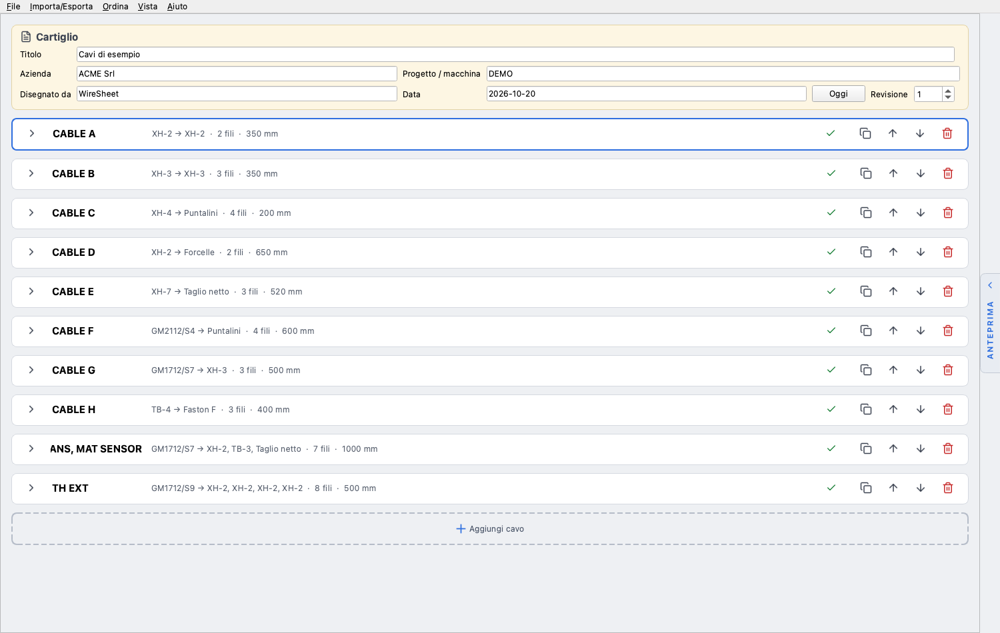
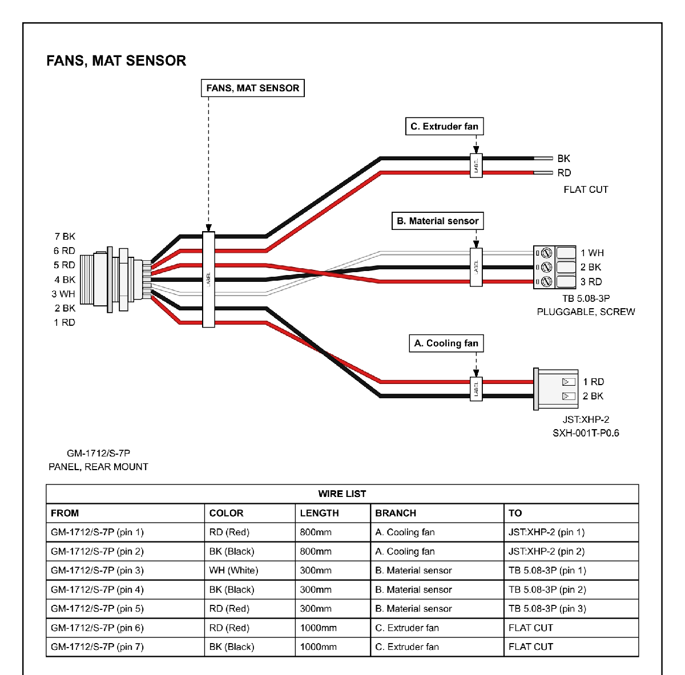

<p align="center">
  
</p>

<h1 align="center">WireSheet</h1>

<p align="center">
  Programma desktop per disegnare <b>tavole di cablaggio</b> e esportarle in PDF:<br>
  estremità 1 → fili → estremità 2, con etichette, WIRE LIST e cartiglio.
</p>

<p align="center">
  <a href="https://github.com/GiacomoGuaresi/WireSheet/actions/workflows/ci.yml"></a>
  <a href="https://github.com/GiacomoGuaresi/WireSheet/releases/latest"></a>
  
  
  <a href="LICENSE"></a>
</p>

---

Descrivi i cavi in una finestra a card (o importali da Excel/CSV) e WireSheet genera un PDF A3 pronto per chi deve cablare: il disegno di ogni cavo con i connettori reali, i colori dei fili, le etichette e la tabella dei collegamenti.

<p align="center">
  
  
</p>

## Funzionalità

- **Editor a card**: una card per cavo, con estremità P1/P2, miniatura del componente, tabella dei fili (pin, colore, lunghezza, sezione) e validazione in tempo reale.
- **Cavi a più rami**: un connettore in ingresso e più uscite, ognuna con il proprio componente e la propria etichetta.
- **Componenti supportati**: JST XH 2–7 poli, connettori circolari GM a pannello (GM-1312, GM-1712, GM-2112), morsettiera a innesto 5,08 da 2 a 8 poli, puntalini, forcelle, faston femmina 6,3, taglio netto.
- **Colori IEC 60757**, anche bicolore (es. `YE/GN`), e sezioni in mm² e/o AWG con conversione automatica.
- **Export PDF A3** con cornice, cartiglio (titolo, azienda, progetto, autore, data, revisione) e numerazione delle pagine.
- **Import/export Excel e CSV**, con template scaricabile: una riga per filo, intestazioni anche in inglese, valori tolleranti (`rosso`/`RD`, `12,5`).
- **Anteprima live** del singolo cavo o del foglio in cui finirà.
- **File di progetto** `.wiresheet` (JSON leggibile) con revisione incrementata a ogni salvataggio.
- **Controllo aggiornamenti**: all'avvio (disattivabile) o dal menu *Aiuto*; se c'è una versione nuova propone di aprire la pagina della release.

## Download

Gli eseguibili sono nella pagina [Releases](https://github.com/GiacomoGuaresi/WireSheet/releases/latest):

| Sistema | File |
|---|---|
| Windows 10/11 (x64) | `WireSheet-windows-x64.zip` → contiene `WireSheet.exe` |
| macOS (Apple Silicon) | `WireSheet-macos-arm64.zip` → contiene `WireSheet.app` |

> [!NOTE]
> Gli eseguibili non sono firmati. Su **Windows**, se SmartScreen blocca l'avvio, scegli *Ulteriori informazioni → Esegui comunque*.
> Su **macOS**, al primo avvio fai clic destro su `WireSheet.app` → *Apri*, oppure esegui `xattr -cr WireSheet.app`.

## Avvio da sorgente

Serve Python 3.12 o superiore.

```bash
git clone https://github.com/GiacomoGuaresi/WireSheet.git
cd WireSheet
python -m venv .venv

# Windows
.\.venv\Scripts\python.exe -m pip install -r requirements.txt
.\.venv\Scripts\python.exe -m wiresheet

# macOS
.venv/bin/python -m pip install -r requirements.txt
.venv/bin/python -m wiresheet
```

Altri comandi utili:

```bash
python -m wiresheet progetto.wiresheet   # apre direttamente un progetto
python -m wiresheet.demo                 # crea demo.pdf con 10 cavi di esempio
python -m pytest -q                      # test (anche senza display: piattaforma Qt offscreen)
```

## Build degli eseguibili

Gli eseguibili si creano con [PyInstaller](https://pyinstaller.org/) a partire da [`packaging/wiresheet.spec`](packaging/wiresheet.spec):

```bash
python -m pip install pyinstaller pillow
pyinstaller --noconfirm packaging/wiresheet.spec   # → dist/WireSheet.exe oppure dist/WireSheet.app
```

PyInstaller non fa cross-compilazione: l'`.exe` si crea su Windows, l'`.app` su macOS.

### Pipeline

- **CI** ([`ci.yml`](.github/workflows/ci.yml)): a ogni push su `main` e a ogni pull request esegue i test su Windows e macOS.
- **Release** ([`release.yml`](.github/workflows/release.yml)): al push di un tag `v*` controlla che corrisponda alla versione dell'app, esegue i test, crea gli eseguibili per Windows e macOS e pubblica una GitHub Release con le note generate dai commit.

La versione si cambia solo in [`wiresheet/__init__.py`](wiresheet/__init__.py) (`__version__`); poi si crea il tag corrispondente:

```bash
git commit -am "Versione 1.0.1" && git push
git tag v1.0.1
git push origin v1.0.1
```

Dalla scheda *Actions* si può anche lanciare *Release* a mano per ottenere gli eseguibili come artifact, senza pubblicare una release.

## Documentazione

La documentazione (in italiano) è in [`docs/`](docs/README.md):

| Documento | Contenuto |
|---|---|
| [Getting started](docs/getting-started.md) | Installazione, uso della finestra, test |
| [Architettura](docs/architecture.md) | Struttura del codice e responsabilità dei moduli |
| [Modello dati](docs/data-model.md) | `Project`, `Cable`, `Branch`, `End`, `Wire`, formato del file di progetto |
| [Regole di disegno](docs/drawing-rules.md) | Geometria, simboli, testi, impaginazione |
| [Componenti](docs/components.md) | Connettori, terminali e colori dei fili |
| [Import Excel/CSV](docs/import-excel-csv.md) | Template, colonne e regole di import |
| [Roadmap](docs/roadmap.md) | Step completati e idee future |

## Stack

[Python 3.12](https://www.python.org/) · [PySide6 / Qt 6](https://doc.qt.io/qtforpython-6/) per interfaccia, disegno vettoriale (`QPainter`) e PDF (`QPdfWriter`) · [openpyxl](https://openpyxl.readthedocs.io/) per i file Excel · [pytest](https://pytest.org/) · [PyInstaller](https://pyinstaller.org/) per gli eseguibili.

> WireSheet si chiamava *CableGen*: i progetti `.cablegen` si aprono ancora.

## Licenza

[MIT](LICENSE) © Giacomo Guaresi
